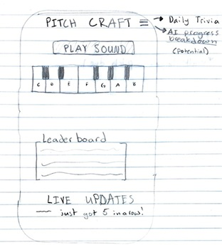
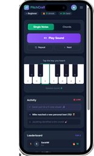
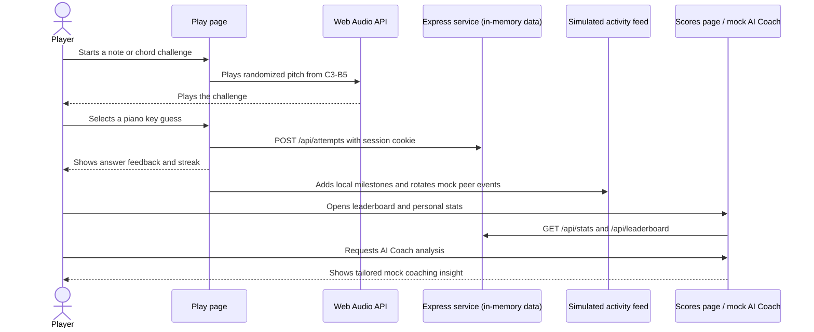

### Pitch Royale
curtislingwall.click

[My Notes](docs/notes.md)

## Running and deploying the service

See [local setup and service deployment instructions](docs/deployment.md).
Use `bash scripts/deployService.sh -n` to test and verify a deployment package
locally. The service script deploys both Express and React; the old React script
now forwards to it. Live deployment and public HTTPS checks are still pending.

| Method | Endpoint | Login required | Purpose |
| --- | --- | --- | --- |
| GET | /api/health | No | Service health |
| POST | /api/auth/register | No | Create account with BCrypt password hash |
| POST | /api/auth/login | No | Issue HttpOnly session cookie |
| DELETE | /api/auth/logout | No | Invalidate session and clear cookie |
| GET | /api/user/me | Yes | Current account |
| POST | /api/attempts | Yes | Validate and save a game guess |
| GET | /api/stats | Yes | Personal game statistics |
| GET | /api/leaderboard | No | Rankings by best streak |

Users, sessions, and attempts are held in server memory and reset on restart.
Guest play is not saved. The frontend fetches music trivia directly from
[The Trivia API](https://the-trivia-api.com/), with click-to-reveal answers.

**Pitch Royale is a web-based ear training game where you learn to identify notes and chords. When you start a round, the computer plays a sound, and you click a piano key or chord button on your screen to guess what you just heard. Getting correct answers earns you points, builds a streak, and moves your name up a leaderboard saved to your account. Pop-up feeds will show when other live players hit milestones, and show daily music trivia. Later versions will include both single and multi-player options.**

### Elevator pitch

Imagine you're at a party, relishing in all the glory that comes from being the star of the party. Then, your friend John (who has perfect pitch) walks in. Suddenly, someone in the room taps their finger on the wall. 

"What note was that?" they ask.

"D flat," John replies. 

Now, you are no longer the star of the party, John is.

Want to take it back? Try Pitch Royale.

### Design

### Key features

Piano & Sound Player - Plays randomized single notes or chords across three octaves. The user guesses with an interactive piano keyboard.

Stats & Streak Tracking - Express calculates account statistics from saved guesses. Registration uses BCrypt password hashing; login uses an HttpOnly session cookie. Data is in server memory until database support is added.

Leaderboard & Notifications - Loads high streaks from the public backend leaderboard. A simulated activity feed mixes sample peer updates with the current player's milestones; it is not connected to a WebSocket server.

Music Trivia - Fetches music questions from The Trivia API; players click to reveal the answer.

AI Breakdown - A mocked AI Ear-Training Coach generates practice advice from the player's server-loaded telemetry; it does not call an LLM service.

### Technologies

The project uses the following technologies; database and WebSocket integrations remain future work.

- **HTML** - HTML for the piano keys, control buttons, score displays, and navigation in the menu.
- **CSS** - Styles the app with a dark theme, piano-key feedback states, and responsive layouts for mobile and desktop.
- **React** - React components and hooks power the interactive pages, game state, and user interface updates.
- **Web Audio API** - A browser oscillator synthesizer plays single notes, major/minor chords, and reference C4 across a three-octave C3-B5 range.
- **Service** - Node.js and Express serve the React build and provide authentication, attempts, personal statistics, and leaderboard endpoints. React fetches music trivia directly from a third-party API.
- **DB/Login** - BCrypt hashes passwords and server-side sessions authenticate accounts. Accounts and game data live in server memory; MongoDB persistence is future work.
- **WebSocket (mocked)** - The Play page simulates peer activity and displays local-player milestones. There is no WebSocket server or connection yet.

## 🚀 Specification Deliverable

For this deliverable I did the following. I checked the box `[x]` and added a description for things I completed.

- [x] I completed the prerequisites for this deliverable (Git commit requirement) - Project work is tracked in Git.
- [x] Proper use of Markdown - Added headings, lists, links, images, and a Mermaid diagram.
- [x] A concise and compelling elevator pitch - Introduced Pitch Royale with a short story.
- [x] Description of key features - Listed the ear-training game, stats, leaderboard, trivia, and AI breakdown.
- [x] Description of how you will use each technology including your 3rd party API and use of WebSocket - Explained planned use of HTML, CSS, React, services, MongoDB, and WebSockets.
- [x] One or more rough sketches of your application. Images must be embedded in this file using Markdown image references. - Embedded two design sketches.

## 🚀 AWS deliverable

For this deliverable I did the following. I checked the box `[x]` and added a description for things I completed.

- [X] **Rented EC2 server**
- [X] **Leased domain name** 
- [X] **Server accessible** from my domain: [https://yourdomainnamehere.click](https://yourdomainnamehere.click) - Not completed yet.

## 🚀 HTML deliverable

For this deliverable I did the following. I checked the box `[x]` and added a description for things I completed.

- [X] I completed the prerequisites for this deliverable (Simon deployed, GitHub link, Git commits) - Added the project GitHub link and committed the work.
- [X] **HTML pages** - Built the home, game, and leaderboard views.
- [X] **Proper HTML element usage** - Used semantic headers, sections, navigation, forms, tables, and buttons.
- [X] **Links** - Added site navigation, account actions, and the project GitHub link.
- [X] **Text** - Added game instructions, account labels, trivia, and leaderboard content.
- [X] **3rd party API placeholder** - Added a space for the future daily-trivia API response.
- [X] **Images** - Added design sketches and music-themed page imagery.
- [X] **Login placeholder** - Added username and password fields with a login button.
- [X] **DB data placeholder** - Added sample leaderboard and player-stat data.
- [X] **WebSocket placeholder** - Added a sample live-activity feed.

## 🚀 CSS deliverable

For this deliverable I did the following. I checked the box `[x]` and added a description for things I completed.

- [X] I completed the prerequisites for this deliverable (Simon deployed, GitHub link, Git commits) - Added the project GitHub link and committed the work.
- [X] **Visually appealing colors and layout. No overflowing elements.** - Created a dark burgundy-and-gold theme with responsive page layouts.
- [X] **Use of a CSS framework** - Imported Bootstrap for layout and components.
- [X] **All visual elements styled using CSS** - Styled the header, navigation, panels, forms, game controls, and tables.
- [X] **Responsive to window resizing using flexbox and/or grid display** - Used Bootstrap's responsive grid plus flexbox and CSS grid.
- [X] **Use of a imported font** - Loaded Great Vibes, Montserrat, and Playfair Display from Google Fonts.
- [X] **Use of different types of selectors including element, class, ID, and pseudo selectors** - Used element, class, ID, hover, and focus selectors.

## 🚀 React part 1: Routing deliverable

For this deliverable I did the following. I checked the box `[x]` and added a description for things I completed.

- [X] I completed the prerequisites for this deliverable (Simon deployed, GitHub link, Git commits) - Simon deployment still needs confirmation.
- [X] **Bundled using Vite** - Added Vite dev and build scripts.
- [X] **Components** - Split the app into home, play, and scores React components.
- [X] **Router** - Added routes for home, play, scores, and a not-found page.

## 🚀 React part 2: Reactivity deliverable

For this deliverable I did the following. I checked the box `[x]` and added a description for things I completed.

- [x] I completed the project prerequisites (project URL and GitHub repository are listed; work is tracked in Git).
- [x] **All functionality implemented or mocked out** - Interactive pages, game controls, local telemetry, simulated live activity, and mock AI coaching are implemented.
- [x] **Hooks** - Used `useState`, `useEffect`, and a custom `useGameSession` hook for reactive UI and game behavior.

## 🚀 Service deliverable

For this deliverable I did the following. I checked the box `[x]` and added a description for things I completed.

- [X] I completed the prerequisites for this deliverable (Simon deployed, GitHub link, Git commits)
- [x] **Node.js/Express HTTP service** - Express listens on port 4000 and provides JSON API routes.
- [x] **Static middleware for frontend** - Express static middleware serves the Vite dist directory with a React Router fallback.
- [x] **Calls to third party endpoints** - The React Home page fetches music questions from The Trivia API.
- [x] **Backend service endpoints** - Added authenticated attempts and personal statistics, plus a public leaderboard.
- [x] **Frontend calls service endpoints** - React uses fetch for accounts, session restoration, game saves, statistics, and rankings.
- [x] **Supports registration, login, logout, and restricted endpoint** - Session cookies authenticate /api/user/me, /api/stats, and POST /api/attempts; logout invalidates the session.
- [x] **Uses BCrypt to hash passwords** - Registration hashes passwords with bcryptjs; login verifies them with bcrypt.compare.

## 🚀 DB deliverable

For this deliverable I did the following. I checked the box `[x]` and added a description for things I completed.

- [ ] I completed the prerequisites for this deliverable (Simon deployed, GitHub link, Git commits)
- [ ] **Stores data in MongoDB** - I did not complete this part of the deliverable.
- [ ] **Stores credentials in MongoDB** - I did not complete this part of the deliverable.

## 🚀 WebSocket deliverable

For this deliverable I did the following. I checked the box `[x]` and added a description for things I completed.

- [ ] I completed the prerequisites for this deliverable (Simon deployed, GitHub link, Git commits)
- [ ] **Backend listens for WebSocket connection** - I did not complete this part of the deliverable.
- [ ] **Frontend makes WebSocket connection** - I did not complete this part of the deliverable.
- [ ] **Data sent over WebSocket connection** - I did not complete this part of the deliverable.
- [ ] **WebSocket data displayed** - I did not complete this part of the deliverable.
- [ ] **Application is fully functional** - I did not complete this part of the deliverable.
